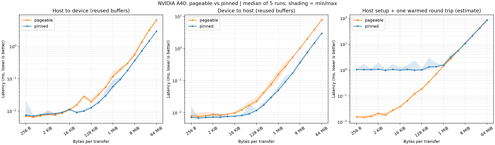
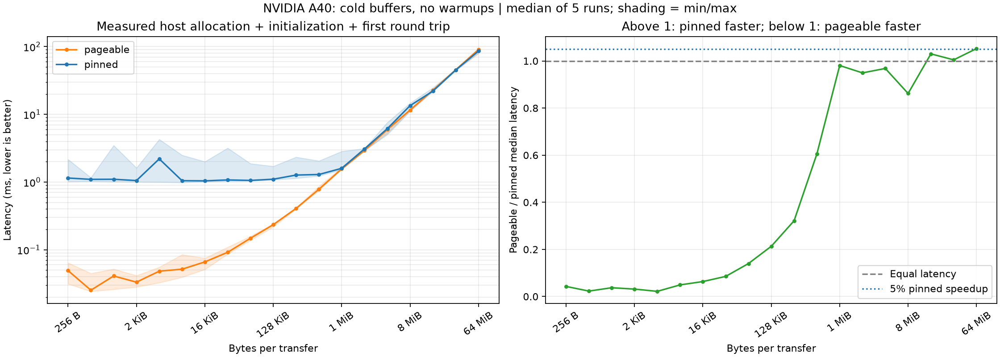
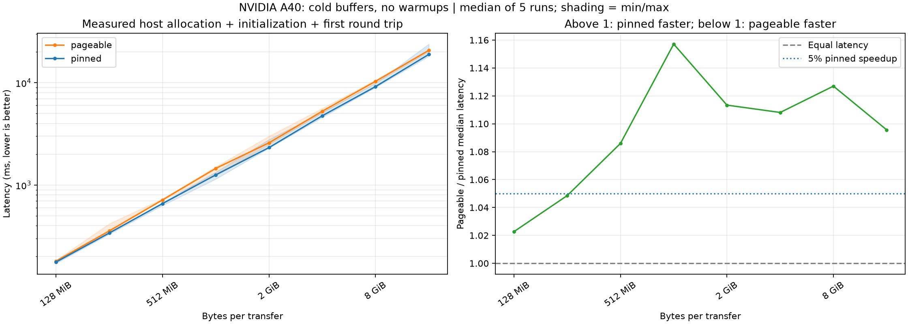

# Pageable versus pinned memory transfers

Compare ordinary pageable host buffers (`malloc`) with pinned, page-locked
host buffers (`cudaMallocHost`). Both are CPU memory; the GPU buffer is allocated
separately with `cudaMalloc`.

Pageable transfers may stage data through an internal pinned buffer before
DMA transfers it to the GPU. Pinned buffers can avoid this staging and often
deliver higher transfer bandwidth. Pinning is more expensive and excessive
pinned memory reduces RAM available for normal OS memory management.

## Build and run

Requires an NVIDIA GPU, a working driver, CUDA Toolkit, CMake 3.24 or newer,
and a supported host C++ compiler.

```bash
./build.sh
./build/memory_transfers
ctest --test-dir build --output-on-failure
```

The default input is 16,777,216 FP32 elements: 64 MiB per transfer. An optional
argument selects the element count. Compare 1 MiB, 16 MiB, and 64 MiB:

```bash
for n in 262144 4194304 16777216; do
  ./build/memory_transfers "$n"
done
```

An optional second argument selects which memory type is measured first:
`./build/memory_transfers 16777216 pinned`. The default is pageable first.

The executable prints separate `key=value` lines for each memory type:

```text
Memory=pageable
host_allocation_ms=...
host_initialization_ms=...
H2D_elapsed_ms=...
H2D_bandwidth_GBps=...
D2H_elapsed_ms=...
D2H_bandwidth_GBps=...
Memory=pinned
...
All transfer correctness checks passed
```

The build uses C++17/CUDA17, Release optimization, and `-lineinfo`. Every `.cu`
file directly in this directory builds as its own executable and must provide
its own `main()`. The build script works from any working directory and forwards
additional arguments to CMake. To compile without a visible GPU, specify an
architecture, for example `./build.sh -DCMAKE_CUDA_ARCHITECTURES=86` for an A40.
Running the benchmark and tests still requires GPU access.

## Measurement boundaries

- Both memory types use identical sizes, input values, and the same device buffer.
- Before timing, initialize and touch both host buffers, copy data to the GPU
  and back, and verify every element.
- Time each direction separately after five warmup copies, averaging 20 copies.
  Verify the final round-trip result again after timing.
- Use a host steady clock around `cudaMemcpy` plus default-stream synchronization
  for each copy. This captures host-side staging and waits for device completion,
  including when pageable H2D copies return early.
- Allocation, host initialization/first-touch, validation, and cleanup are
  excluded from transfer time. Host allocation time covers both host allocation
  calls, not GPU allocation or subsequent first-touch costs. Host initialization
  time separately measures filling both buffers, including first touch. A pageable
  allocation may reserve virtual memory without immediately committing pages,
  so allocation timings alone do not represent the full cost of preparing buffers.
- Effective bandwidth is `bytes_per_transfer / elapsed_seconds / 1e9`, in decimal
  GB/s. This measures completed CPU/GPU transfers, not GPU DRAM bandwidth or
  kernel computation. API and synchronization overhead are included.

## Interpreting the comparison

Expect pinned memory to often improve large-transfer bandwidth, not necessarily
every small transfer. Small transfers can be dominated by API and synchronization
overhead. Reusing pinned buffers amortizes allocation costs.

This benchmark uses synchronous copies, so it does not demonstrate overlap.
Pinned buffers also enable reliably asynchronous host/device copies with
`cudaMemcpyAsync`; suitable streams and hardware are needed to overlap transfers
with computation.

Run on an otherwise idle GPU and repeat the size sweep. Pageable is measured
before pinned by default, so clock changes, system load, caches, and measurement order can
affect the comparison. Do not interpret one run as a universal speedup.

CUDA failures, invalid arguments, allocation failures, and incorrect results
exit nonzero. Tests cover small and irregular element counts and reject zero.

## Size sweep and latency graph

```bash
./build.sh
python -m venv .venv
.venv/bin/python -m pip install -r requirements.txt
.venv/bin/python plot_transfers.py
```

The script measures powers of two from 256 B through 64 MiB, with five
independent paired runs per size. It alternates measurement order across runs
and sizes. Each run still averages 20 completed copies after five warmups per
direction. Use `--repeats 7` for more samples.

Results are saved in `results/transfer_latency.csv`, `.png`, and `.svg`
(rerunning replaces these files). The CSV preserves individual runs, GPU,
timestamp, timing settings, and measurement order. The graph shows medians
with min/max shading:

1. H2D transfer latency with already allocated and initialized buffers.
2. D2H transfer latency with already allocated and initialized buffers.
3. Host allocation + initialization + one warmed H2D/D2H round-trip estimate.

The third panel is a model using separately measured setup and warmed transfer
times, **not a measured cold-start end-to-end latency**. It excludes freeing
buffers, device allocation, first-copy effects, and CUDA context creation.

The script reports the first sampled size at which pageable median latency
is at least 1.05 times pinned latency, remaining so at every larger sampled
size (at least three sizes must qualify). This 5% speedup criterion avoids
calling a tiny median difference a practical benefit, but is not a statistical
confidence test. Inspect the spread and rerun on an idle system.

It also estimates how many round trips amortize pinned host setup:

```text
extra_setup = pinned_setup - pageable_setup
savings_per_round_trip = pageable_round_trip - pinned_round_trip
```

Pinned wins in this simplified model when
`round_trips * savings_per_round_trip > extra_setup`. The estimate assumes
stable transfer latency and buffer reuse. There is no universal beneficial
size: transfer direction, reuse count, hardware, and load all matter.

### Measured results: NVIDIA A40, 2026-11-08

The saved sweep contains 19 sizes, five paired runs per size, and both memory
types: 190 measurements. All round-trip correctness checks passed.



Selected median latencies (microseconds; transfer time excludes host setup):

| Size | Pageable H2D | Pinned H2D | Pageable D2H | Pinned D2H |
|---|---:|---:|---:|---:|
| 4 KiB | 7.512 | 8.213 | 8.414 | 7.251 |
| 32 KiB | 15.324 | 9.139 | 12.293 | 8.236 |
| 256 KiB | 31.709 | 18.227 | 41.845 | 17.266 |
| 1 MiB | 118.879 | 57.709 | 155.800 | 49.571 |
| 8 MiB | 547.972 | 363.736 | 1,029.190 | 363.332 |
| 64 MiB | 6,532.160 | 2,901.610 | 7,847.070 | 2,970.300 |

**When is pinned beneficial in this sweep?**

- With reused buffers, H2D had a sustained speedup of at least 5% from
  **32 KiB** upward. At 4 KiB, pinned H2D was slightly slower.
- D2H met that criterion from the smallest tested size, **256 B**, upward.
  This does not locate a lower crossover: smaller sizes were not tested.
  Tiny-transfer absolute differences are around microseconds, and run-to-run
  variability can overlap; do not treat this as a universal small-buffer rule.
- Including host allocation and initialization, no sustained 5% speedup was
  observed for a single warmed round trip. Pinned setup often erased much
  of the transfer benefit. At 64 MiB, the setup-inclusive median estimate was
  84.137 ms for pinned versus 86.254 ms for pageable: only about 2.5% lower.
- The amortization model estimated about **100 round trips at 32 KiB**,
  **10 at 512 KiB**, and **2 at 1 MiB** to recover pinned setup cost.
  These estimates use median setup and round-trip times, not a measured
  repeated application workload.

The widening transfer-only gap at larger sizes is consistent with pageable
staging costs and the direct DMA path available with pinned buffers. Timings
alone do not prove the internal transfer path. For this workload, reuse pinned
buffers for repeated transfers; avoid paying the pinning cost for each small
transfer. Rerun the sweep for your actual GPU, sizes, and reuse pattern.

## Experiment 2: measured host setup and first round trip

```bash
./build.sh
./build/memory_transfers 16777216 pageable cold
.venv/bin/python plot_transfers.py --cold
```

This experiment directly measures one continuous host steady-clock interval:
allocate two host buffers, initialize both (including first touch), copy the
input to the GPU, and copy it back into the output buffer. There are **no
warmups and exactly one H2D/D2H round trip per memory type per run**.
`cold_setup_round_trip_ms` is the directly measured interval, not a sum of
separate medians or warmed transfer estimates. H2D and D2H metrics in cold mode
refer to those first copies rather than repeated averages.

Validation and freeing buffers happen after the interval. CUDA context creation
and device allocation happen before it. Thus this is a **cold-host-buffer**
experiment, not full process startup latency. The device buffer is shared
between memory types, and driver/OS caches may persist; order is alternated
across the independent paired processes to reduce bias.

The same 19-size, five-repeat sweep saves separate files:
`results/cold_transfer_latency.csv`, `.png`, and `.svg`, preserving the original
warmed experiment. The first panel shows directly measured total latency with
median curves and min/max shading. The second shows pageable/pinned median
latency: above 1 means pinned is faster; above 1.05 meets the 5% speedup criterion.

### Cold-buffer results: NVIDIA A40, 2026-11-08



Median directly measured total latency across five paired runs:

| Bytes per transfer | Pageable (ms) | Pinned (ms) | Lower median |
|---|---:|---:|---|
| 1 MiB | 1.563540 | 1.594260 | Pageable |
| 2 MiB | 2.930090 | 3.086470 | Pageable |
| 8 MiB | 11.577400 | 13.431800 | Pageable |
| 16 MiB | 22.667700 | 22.004100 | Pinned |
| 32 MiB | 45.292700 | 45.079800 | Pinned |
| 64 MiB | 90.458700 | 85.952600 | Pinned |

The directly measured experiment **does not support a general "above 1 MiB,
allocate pinned for one round trip" rule**. Pageable remained faster at several
larger sizes. Pinned had lower medians from 16 MiB upward in this sweep, but
its advantage was only about 0.5% at 32 MiB and about 5.0% lower latency at
64 MiB. The shaded run ranges overlap at some large sizes.

No sustained 5% speedup threshold was established: only the largest size met
that criterion, leaving no larger samples to confirm persistence. All 190
measurements used zero warmups and one round trip per memory type, and all
correctness checks passed.

At small sizes, pinned host setup dominated the total, typically around a
millisecond on this system. Faster transfers offset that cost only gradually.
At larger sizes, host initialization and transfer time both contribute, so a
transfer-only speedup need not produce a similarly large total-latency speedup.
For one-off work, measure the actual setup-inclusive path; for repeated work,
allocate pinned buffers once and reuse them.

### Larger sizes

Configure power-of-two size bounds in bytes. For example, extend the cold
experiment from 128 MiB through 16 GiB, retaining five paired runs per size:

```bash
.venv/bin/python plot_transfers.py --cold \
  --min-bytes 134217728 --max-bytes 17179869184 \
  --output-dir results/large
```

The script checks Linux available host RAM and the cgroup v2 container limit
before the sweep and each paired run, retaining a 25% reserve for staging,
the driver, and other activity. It saves the CSV after every completed pair,
so a later error does not discard earlier measurements. CUDA allocation
failures still stop the sweep explicitly.

This container has a roughly 46.6 GiB host-memory limit. A 32 GiB transfer
would require two 32 GiB host buffers (64 GiB total), exceeding that limit;
the same experiment is therefore limited to 16 GiB here. The A40's GPU memory
is not the limiting factor for 32 GiB. The preflight check is a conservative
budget check, not a reservation or guarantee against concurrent memory use.

### Large cold-buffer results: NVIDIA A40, 2026-11-08



Five paired runs at each of eight sizes; zero warmups, one round trip:

| Bytes per transfer | Pageable total (s) | Pinned total (s) | Pageable/pinned |
|---|---:|---:|---:|
| 128 MiB | 0.180749 | 0.176737 | 1.023 |
| 256 MiB | 0.356545 | 0.340043 | 1.049 |
| 512 MiB | 0.716524 | 0.659834 | 1.086 |
| 1 GiB | 1.457550 | 1.259630 | 1.157 |
| 2 GiB | 2.591280 | 2.327410 | 1.113 |
| 4 GiB | 5.277130 | 4.762300 | 1.108 |
| 8 GiB | 10.352200 | 9.185820 | 1.127 |
| 16 GiB | 20.768800 | 18.955600 | 1.096 |

For this large-size sweep, **512 MiB was the first sampled size with a
sustained speedup of at least 5%**, including host allocation, initialization,
and the first round trip. It remained above that criterion through 16 GiB.
At 16 GiB, pinned reduced total median latency by about **8.7%** (1.81 seconds).
This establishes an observed criterion across these sampled sizes, not an
exact crossover or a statistical guarantee.

Setup remains important: at 16 GiB, median pinned allocation alone took about
11.4 seconds. Pageable allocation was cheap but subsequent initialization
included substantial first-touch costs. Pinning can move page-preparation work
into allocation, so comparing allocation alone would be misleading. The
direct total interval includes both stages.

All 80 measurements passed correctness checks, and host/GPU memory was released
after the sweep. The 32 GiB case was not attempted because its 64 GiB host-buffer
requirement exceeds the container limit; these results do not extrapolate to it.

## Experiment summary and conclusions for this NVIDIA A40 system

### Common setup

- GPU: NVIDIA A40, with about 45 GiB of device memory available before the
  large sweep. Linux container host-memory limit: about 46.6 GiB.
- Build: Release, C++17/CUDA17, with CUDA `-lineinfo`.
- Data: FP32 arrays with identical input values for both memory types.
  The size on each graph is **bytes per transfer**, not combined round-trip
  traffic. A size of `S` requires two `S`-byte host buffers and one `S`-byte
  device buffer; the round trip transfers `2 * S` bytes.
- Pageable host allocation: `malloc`; pinned host allocation: `cudaMallocHost`.
  Both host buffers are initialized, including first touch.
- Transfers: `cudaMemcpy` followed by default-stream synchronization.
  A host steady clock includes pageable staging and waits for transfer completion.
- Each size has five independent paired process runs, with memory-type order
  alternated. Results use medians; shaded regions show the min/max across runs,
  not statistical confidence intervals.
- Correctness is checked outside the timed intervals. CUDA context creation,
  device allocation, and buffer cleanup are excluded from the setup-inclusive
  measurements.

| Experiment | Sizes per transfer | Timed work | Warmups and repeats |
|---|---|---|---|
| Reused buffers | 256 B to 64 MiB | H2D and D2H separately; host setup excluded | 5 warmups, average of 20 copies per direction per run |
| Cold buffers, small sizes | 256 B to 64 MiB | Host allocation + initialization + first H2D/D2H round trip | No warmups, one round trip per run |
| Cold buffers, large sizes | 128 MiB to 16 GiB | Same directly measured setup-inclusive interval | No warmups, one round trip per run |

The initial graph's third panel was a setup-plus-warmed-transfer **estimate**.
The two cold-buffer sweeps directly measured the first-round-trip interval and
are the relevant evidence for the one-off allocation decision.

### Practical conclusion for a single round trip

On **this NVIDIA A40 and host/container configuration**, consider paying the
initial pinning cost around **256 MiB**, where the measured benefit was modest.
The stronger evidence begins at **512 MiB**: every larger sampled size through
16 GiB met our `pageable_median / pinned_median >= 1.05` speedup criterion.

| Size per transfer | Pageable total (ms) | Pinned total (ms) | Pinned latency reduction |
|---|---:|---:|---:|
| 256 MiB | 356.545 | 340.043 | 4.6% |
| 512 MiB | 716.524 | 659.834 | 7.9% |
| 1 GiB | 1,457.550 | 1,259.630 | 13.6% |
| 16 GiB | 20,768.800 | 18,955.600 | 8.7% |


The left panel shows measured setup-inclusive latency; the right shows the
pageable/pinned median latency ratio. At 256 MiB the ratio is about 1.049,
just below the dotted 1.05 criterion. From 512 MiB through 16 GiB, every
sampled size exceeds that criterion, supporting the conclusion above.
The shaded latency ranges show min/max variability across five paired runs.

These totals include allocating and initializing both host buffers and one
completed round trip. Pinned allocation is expensive, but its transfer savings
can offset setup costs at large sizes. The benefit is not monotonic, and the
observed range is not an exact crossover or a guarantee for all A40 machines:
host RAM, CPU, interconnect, driver, load, and buffer preparation also matter.
Units here are binary **MiB/GiB**, not decimal MB/GB.

For **repeated transfers with reused buffers**, pinned memory can be worthwhile
at much smaller sizes: the transfer-only H2D sweep showed a sustained speedup
from 32 KiB. Do not apply the one-off 256-512 MiB guideline to that reuse case.
